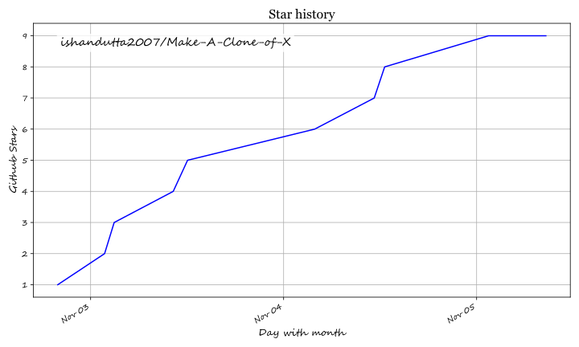

<div align="center">


# MACX: Make A Clone of X

### One MCP server and CLI for AI-assisted reverse engineering across binaries, applications, and runtime behavior.

**See a feature you like. Understand how it works, down to the binary level.**

<a href="https://github.com/ishandutta2007/Awesome-Awesome-Awesome"></a><a href="https://discord.gg/jc4xtF58Ve"></a> [](https://www.npmjs.com/package/macx-agents)
[](LICENSE) <a href="https://github.com/ishandutta2007"></a>

<code>npx macx-agents setup</code>

</div>

> [!IMPORTANT]
> This is **MACX** — a simplified, minimal-feature edition focused on core
> reverse-engineering workflows via CLI and MCP.

---

**MACX** 🛡️ (npm package: [`macx-agents`](https://www.npmjs.com/package/macx-agents)) is a **local-first reverse-engineering toolkit for AI agents**. It packages a **Model Context Protocol (MCP) server** and a **command-line interface (CLI)** into one tool that lets your agent decompile and analyze software you are authorized to examine — without needing the original source code.

See a feature in an app that you want in your own product? Ask your agent to investigate it with MACX. It can inspect the app without its source code, explain how the feature works, show the evidence, and build a version for your project.

MACX connects your agent to tools for inspecting native binaries, JavaScript and Electron apps, .NET assemblies, and websites. You can also use the same tools from your terminal. Analysis runs locally, and results include the evidence and limitations behind each conclusion.

Setup registers MACX with your agent and installs matching workflow instructions. Native analysis can use an existing Hopper, Ghidra, or IDA installation; setup can optionally install Hopper with approval. Static JavaScript analysis needs no native analysis engine.

## Table of contents

- [🚀 Quick start](#quick-start)
- [🔍 How MACX works](#how-macx-works)
- [🎯 What you can analyze](#what-you-can-analyze)
- [❓ FAQ](#faq)
- [📚 Documentation](#documentation)
- [⚖️ Disclaimer](#disclaimer)
- [🤝 Contributing](#contributing)
- [📄 License](#license)

## 🚀 Quick start

### 🤖 Set up your agent

With Node.js and npm installed, run:

```bash
npx macx-agents setup
```

Choose your agents, review the proposed changes, and approve them. Setup adds
MACX's MCP server and matching workflow instructions, with backups of existing
configuration. Restart your agent afterward.

Setup supports 🤖 Claude Code, Codex, Cursor, Gemini CLI, Grok Build and other agents.

### 💬 Ask your agent

```text
Understand how search works in the Notes app, show me the evidence, and build a
similar feature for my project.
```

Replace Notes with your target app and the feature you want to understand.

### 🖥️ Use the terminal

Inspect an extracted JavaScript/Electron app directory or ASAR:

```bash
npx -y macx-agents@latest analyze-javascript-application /absolute/path/to/app --json
```

The result includes modules, imports, Electron boundaries and their evidence.

To install the `macx` command for regular use:

```bash
npm install --global macx-agents
macx --help
```

### 🔄 Update MACX

For a CLI installed with `npm install --global`:

```bash
macx update
```

For agent setup through `npx`:

```bash
npx macx-agents@latest setup
```

Review the setup changes and restart your agent.

## 🔍 How MACX works

Your agent calls MACX through MCP to inspect the target and trace relevant code.
MACX returns findings with their evidence. The agent uses them to ask follow-up
questions, explain the behavior, or write and test an implementation.
CLI commands use the same workflows.

## 🎯 What you can analyze

MACX requires Node.js 22.x (>=22.23.4), 24.x (>=24.22.1), or 26.12.1+, plus npm.

| Target                  | What MACX returns                                                              |
| ----------------------- | ------------------------------------------------------------------------------ |
| Native binaries         | Pseudocode, assembly, strings, symbols, calls and references                   |
| JavaScript / Electron   | Modules, imports, source maps, routes, IPC and native add-on relationships     |
| Websites                | Page structure, scripts, network observations and requested screenshots        |
| .NET assemblies         | Metadata, CIL instructions, declared native dependencies and build comparisons |
| Desktop installations   | Runtime candidates, supporting files, component markers and next probes        |
| Go binaries             | Embedded compiler version, modules, replacements and build settings            |
| Rust binaries           | Embedded cargo-auditable crate names, versions, sources and dependency edges   |
| SQLite databases        | Tables, columns, indexes, views, triggers and selected ordinary-table rows     |

Static JavaScript and .NET inspection read the supplied files without running
the application.

For native-binary inspection, MACX supports Hopper, Ghidra, and IDA providers.

## ❓ FAQ

<details>
<summary><strong>Which agents can use MACX?</strong></summary>

Any agent that supports local MCP servers.

</details>

<details>
<summary><strong>Do I need Hopper, Ghidra or IDA?</strong></summary>

Deep native analysis uses one of them. Static JavaScript and .NET inspection
work without a native analysis engine.

</details>

<details>
<summary><strong>What code does MACX return?</strong></summary>

Native analysis returns pseudocode and assembly. JavaScript/Electron analysis
recovers modules and their relationships. Your agent uses these findings to
write and test an implementation.

</details>

<details>
<summary><strong>Does MACX upload my app?</strong></summary>

MACX analyzes targets locally. Your agent receives the tool results, and its
model provider has its own data policy.

</details>

## 📚 Documentation

- 🛠️ [Installation and setup](docs/installation.md): agent registration, provider configuration, updates and uninstall.
- 🧾 [CLI and Evidence](docs/cli.md): commands, provider selection, snapshots and exit statuses.

Report vulnerabilities through [SECURITY.md](SECURITY.md).

## ⚖️ Disclaimer

See [DISCLAIMER.md](DISCLAIMER.md) for responsible-use guidance.

MACX is for lawful research, education, interoperability, software preservation,
and analysis of software you own or are authorized to examine.

## 🤝 Contributing

We'd love your help with MACX! 💜 [Open an issue](https://github.com/ishandutta2007/Make-A-Clone-of-X/issues) to
report a bug or suggest a feature, or [send a pull request](https://github.com/ishandutta2007/Make-A-Clone-of-X/pulls)
to improve the code or docs.

See [CONTRIBUTING.md](CONTRIBUTING.md) for development setup and checks.

## 📄 License

[MIT](LICENSE)

MACX-authored code is licensed under MIT. Third-party material retains its own
licenses and copyright notices.

**You must legally obtain and be authorized to use commercial tools**, including
IDA Pro / Hex-Rays decompilers, Hopper, and JEB, under their applicable
licenses. MACX grants no tool license, key, or activation entitlement.

## ⭐ Star History

[](https://star-history.dera.page/#ishandutta2007/Make-A-Clone-of-X)

## ⭐ Star History

<a href="https://star-history.com/#ishandutta2007/Make-A-Clone-of-X&Timeline" align="center">
  <picture>
    <source media="(prefers-color-scheme: dark)" srcset="assets/ishandutta2007_Make-A-Clone-of-X_growth.svg">
    
  </picture>
</a>
